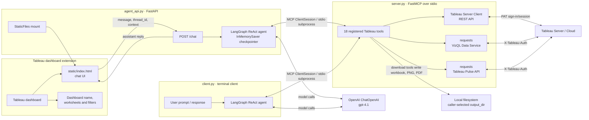

# Architecture

This diagram describes the tracked application entrypoints: `server.py`,
`agent_api.py`, `client.py`, and the Tableau extension in `static/` and
`chat.trex`. The archived and untracked source variants are not part of this
description.

## Request and data flow

- `agent_api.py` starts a FastMCP `server.py` subprocess during FastAPI lifespan,
  initializes an MCP client session, loads the registered tools, and creates a
  LangGraph ReAct agent. The agent is then reused for HTTP chat requests.
- The extension initializes through the Tableau Extensions API. Before each
  message it refreshes dashboard context when possible, then sends
  `message`, `thread_id`, and `context` as JSON to `/chat`. The API prepends
  the context to the message and invokes the agent.
- The agent can call the MCP tools over the subprocess's stdio connection. The
  tools authenticate with a Tableau Personal Access Token for each tool call.
  TSC handles the classic Tableau REST operations; VDS and Pulse calls use
  `requests` with the session's `X-Tableau-Auth` token.
- The final agent message is returned as `reply` to the extension. Tool errors
  can propagate through the agent/API error handling.
- `client.py` is an independent terminal interface: it starts the same
  `server.py` subprocess, loads its tools, invokes its own LangGraph agent, and
  prints responses. It does not pass through the HTTP extension service.
- Workbook, PNG, and PDF download tools write to the local filesystem. The
  project does not configure a database or persistent application cache.
